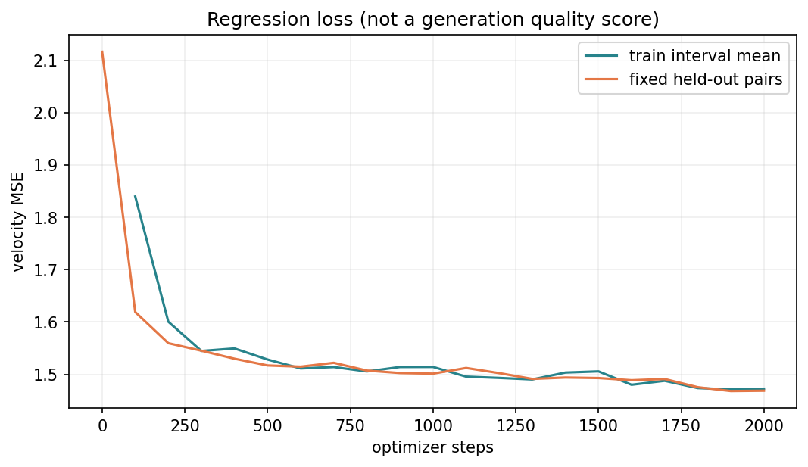
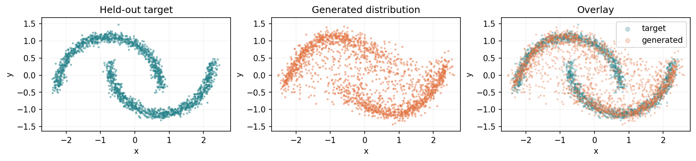
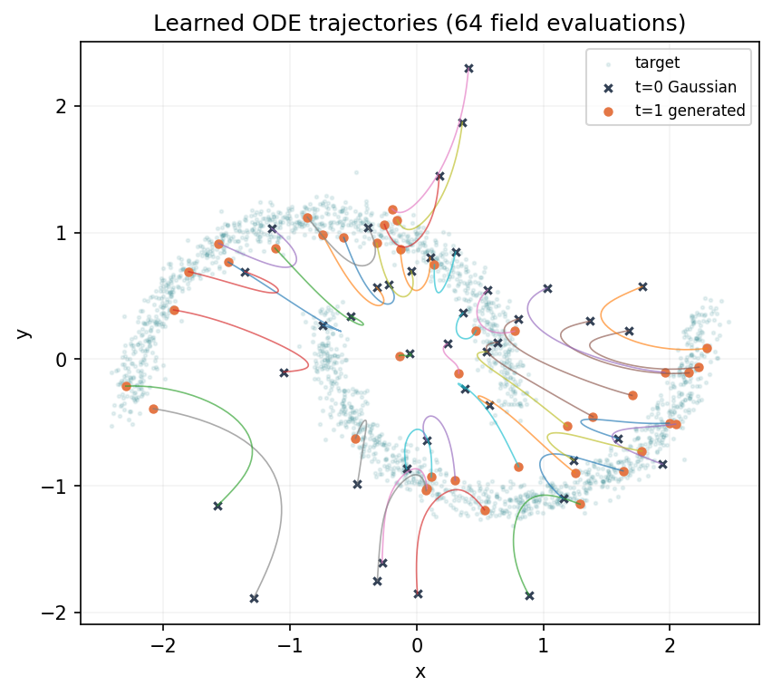
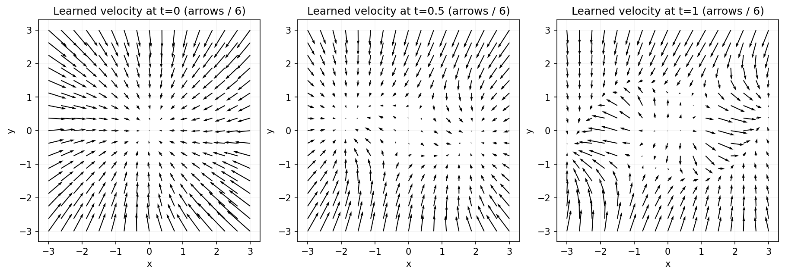
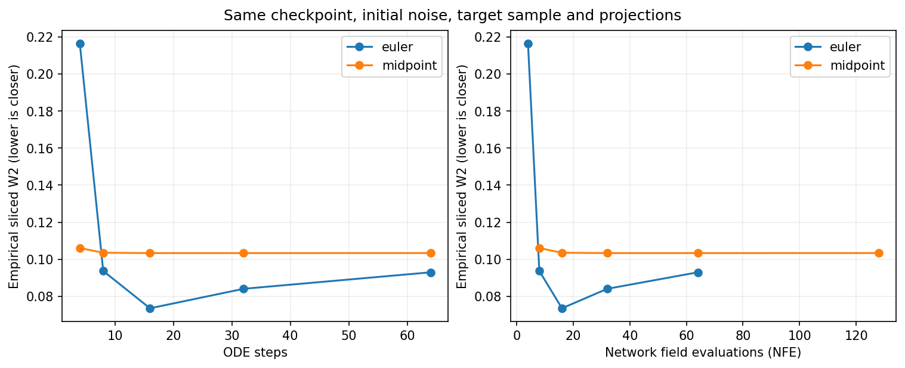

# CPU 验证报告：2D Flow Matching 第一版

日期：2026-10-10。验证对象是本仓库的二维教学实现，不是 Hunyuan3D，不是 V100 性能报告。

## 结论

- 自动测试 **20 项通过**，覆盖解析路径／速度、手算 MSE、常量场积分、midpoint 数值精度、shape、数据复现、checkpoint 重载、推理不改权重、CPU 训练逐位复现、固定比较输入、CLI、headless 图像和 notebook 全部代码单元
- 额外检查：非法配置、非法投影方向、共享画图坐标范围、驱动诊断超时、显式 CUDA 失败而不回退
- `pip check` 和 `compileall` 通过
- moons 2,000 步训练：固定 held-out velocity MSE 从 **2.116129** 降至 **1.468719**
- 生成分布已学到两条弧的大体结构，但中间仍有不应过度解释的弥散点；不能据此宣称充分收敛或高质量
- **未在 V100 上运行**；缺少 SSH 连接与工作目录信息、服务器环境实测

## 环境与版本证据

CPU、float32、1 个 PyTorch CPU thread；Python 3.12.14、PyTorch 2.7.1+cpu、NumPy 2.3.5、Matplotlib 3.10.8。PyTorch 安装在独立 venv 中；复用了已安装的 NumPy／Matplotlib，没有改动全局包或系统驱动。

为了避免“报告自包含自己的 Git hash”的循环，**精确最终提交号**写在配套 `ai3d-practice-lab-cpu-evidence.zip` 的 `manifest.json` 中；其值也必须与 `moons/metadata.json` 的 `environment.git.commit`、`comparison/metadata.json` 的 `environment.git.commit` 一致。最终代码提交后，在 clean tree 上重新运行测试、训练、比较，再由该 HEAD 生成 bundle 和 source ZIP。以证据包中的原始记录为准。

报告图像在最终源码上生成并经过视觉检查；具体时间数据留在各 run 的 metadata／log 中。单次 CPU 时间不是基准测试，不外推到 V100。

## 实際命令

在仓库根目录、已激活环境中：

```bash
python -m pip check
python -m compileall -q src tests
python -m unittest discover -s tests -v
python -m flowlab preflight --device cpu --out runs/final-preflight.json
python -m flowlab train --config configs/moons.json --out runs/moons_final --device cpu
python -m flowlab sample --checkpoint runs/moons_final/checkpoint.pt --out runs/sample_final --method midpoint --steps 32 --seed 123 --samples 2048 --device cpu
python -m flowlab compare --checkpoint runs/moons_final/checkpoint.pt --out runs/comparison_final --steps 4 8 16 32 64 --seed 123 --samples 2048 --device cpu
python -m flowlab train --config configs/gmm8.json --out runs/gmm8_final --device cpu --no-plots
```

单元测试自带 8 步 train／checkpoint／CLI smoke；主实验使用原始配置，不在运行时偷偷更改超参数。小型 GMM 补充运行也完成 2,000 步，不将未画图的 GMM 结果称为已视觉验证。

## 训练证据与尺度

moons：33,794 个可训练参数；seed=42；训练目标池 8,192 点；验证集 2,048 个固定、独立 RNG 生成的配对；batch=256；Adam lr=0.001；3×128 隐藏层。

验证 MSE 为每样本、每坐标的平均值。它衡量随机配对速度回归，不是生成质量评分；不同配对的监督可能冲突，因此不能要求归零。

训练结束后自动诊断：midpoint 32 步，NFE=64，2,048 个点，sample seed=20042，经验 sliced W2 = **0.116754**。

补充 gmm8：初始／最终验证 MSE 为 **3.062303 / 1.925640**，对应自动诊断 sliced W2 = **0.216052**。不同目标分布的这些数不应直接排名。









## 控制变量：仅改变 solver 和步数

同一个最终 checkpoint，同一份 initial noise、同一份目标参考、同一组 128 个投影方向，compare seed=123，点数=2,048。`comparison/inputs.pt` 保存这些输入；checkpoint SHA-256 写在 comparison metadata 中。所有比较点云图共用同一坐标范围。

| 方法 | 步数 | NFE | sliced W2 |
|---|---:|---:|---:|
| Euler | 4 | 4 | 0.216326 |
| Euler | 8 | 8 | 0.093681 |
| Euler | 16 | 16 | 0.073539 |
| Euler | 32 | 32 | 0.084054 |
| Euler | 64 | 64 | 0.092952 |
| midpoint | 4 | 8 | 0.106040 |
| midpoint | 8 | 16 | 0.103511 |
| midpoint | 16 | 32 | 0.103335 |
| midpoint | 32 | 64 | 0.103338 |
| midpoint | 64 | 128 | 0.103345 |



这组数据特意完整保留了非单调结果：**更多步数／更高阶方法没有保证更低的目标分布距离。** 高阶数值积分的精度、已学习场的建模误差、有限样本分布指标是不同对象；这里的指标不能单独诊断哪个因素导致某个点更低。Euler16 的更低数值不是它普遍更好的证明。

训练自动诊断的 seed=20042，而 compare 使用 seed=123。不要将 0.116754 与 0.103338 的差异解释成训练进步或 solver 改善；它们的初始噪声、参考样本和投影方向均不同。

## 通过的验收标准与未覆盖边界

已验收：数学公式／时间方向正确、可训练／可采样、重载可重复、实验控制明确、产物可检查、20 项测试通过。

未验收：V100／CUDA 实跑、跨硬件逐位一致、多个训练 seed 的统计置信区间、分布质量最优、长训练稳定性、checkpoint 自动续训、ShapeVAE、Hunyuan 和任何 3D 输出。Notebook 的代码单元已按顺序执行；没有把浏览器中的 Jupyter UI 当作已测试。

下一步应在获准使用的 V100 服务器执行 [预检与 smoke](../../docs/v100.md)，再用同一份配置复现，而不是立即启动大模型训练。
